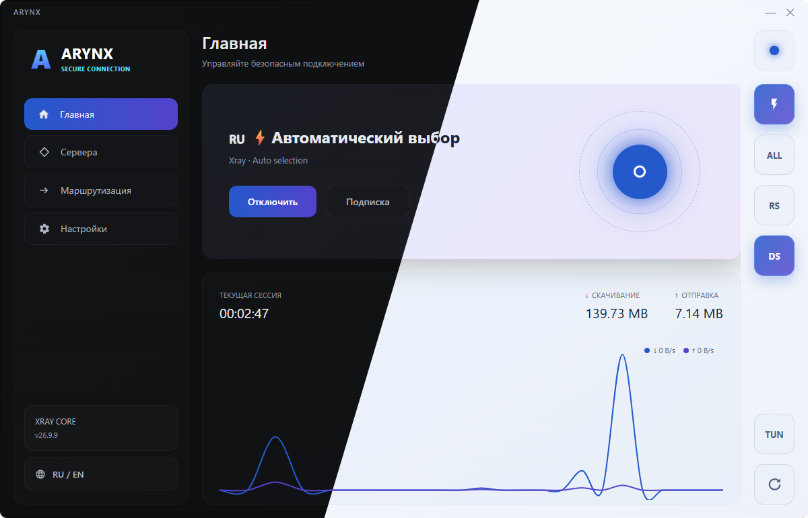

<h1> A R Y N X </h1>
<h3>Ваш трафик. Ваш маршрут.</h3>

GUI-клиент для Windows. Два ядра, гибкая маршрутизация и удобное управление подключением. XRAY / SING-BOX

  
  
  
  

  <a href="https://github.com/GhettoLifeHF/arynx/releases">Скачать</a> ·
  <a href="#features">Возможности</a> ·
  <a href="#protocols">Протоколы</a> ·
  <a href="#discord">Discord SOCKS5</a> ·
  <a href="#start"><b>Быстрый старт</b></a>

---

ARYNX объединяет серверы, подписки и правила трафика в одном приложении. Импортируйте профиль, выберите сервер и подключитесь. Приложение автоматически подберёт **Xray или sing-box** по протоколу и загрузит необходимые компоненты.

   

## Всё для вашего подключения

| Возможность | Что внутри |
| :--- | :--- |
| **Серверы и подписки** | Импорт ссылок, текстовых и Base64-подписок, поддерживаемых JSON/RAW-конфигураций Xray. Автообновление подписок. |
| **Удобный выбор сервера** | Проверка задержки, сортировка, избранное, группы, заметки и теги. |
| **Маршрутизация** | Правила по домену, IP/CIDR, процессу Windows, порту и TCP/UDP. Действия: прокси, напрямую или блокировать. Импорт и экспорт профилей правил. |
| **Прокси и TUN** | Локальный SOCKS/HTTP-прокси, управление системным прокси Windows и виртуальный сетевой адаптер. |
| **Параметры Xray** | TLS-фрагментация для отдельных серверов, настройки защиты DNS/IPv6 и Kill Switch в режиме TUN. |
| **Восстановление связи** | Переподключение при сбоях ядра и изменениях маршрутов, настраиваемое переключение сервера. |
| **Диагностика** | Состояние ядра, проверка локального порта, график трафика Xray и журналы событий. |
| **Интеграция с Windows** | Системный трей, автозапуск и подключение при запуске системы. Русский и английский интерфейс. |

## Два ядра. Широкий выбор протоколов.

| Ядро | Протоколы |
| :--- | :--- |
| **Xray** | VLESS · VMess · Trojan · Shadowsocks · SOCKS5 · HTTP/HTTPS |
| **sing-box** | Hysteria2 · TUIC · WireGuard |

Для совместимых Xray-профилей доступны **Reality, TLS, WebSocket, gRPC, HTTPUpgrade и XHTTP**.

> [!NOTE]
> Пользовательская маршрутизация, TLS-фрагментация и настройки защиты DNS/IPv6 реализованы для Xray. Возможности sing-box отличаются; поддержка параметров зависит от протокола и серверной конфигурации.

## Discord SOCKS5

Встроенная интеграция для работы Discord через прокси. ARYNX устанавливает необходимые компоненты, проверяет SHA-256 загруженного архива и перезапускает Discord. Автосинхронизация поддерживает файлы интеграции в рабочем состоянии.

Компоненты обновляются отдельно от приложения и ядра, без отключения активного Xray-соединения.

## Подключение за несколько шагов

1. Запустите **`ARYNX.exe`**.
2. Добавьте ссылку подключения, конфигурацию или URL подписки.
3. Включите **системный прокси** или **TUN**. Для ручной настройки приложения используйте `127.0.0.1:10808`.
4. Выберите сервер и нажмите **«Подключиться»**.

Системный прокси работает с приложениями, учитывающими настройки Windows. TUN направляет трафик через виртуальный адаптер и требует прав администратора.

**Требования:** Windows 10 x64 версии 1709 или новее либо Windows 11 x64, Microsoft Edge WebView2 Runtime и доступ к сети для загрузки компонентов и подписок.

> [!TIP]
> Для подключения нужен ваш сервер или подписка провайдера. При возникновении ошибки откройте диагностику ядра; подробные журналы находятся в `CrashLogs`.

## Обновления

ARYNX загружает необходимые Xray, sing-box и Wintun автоматически. Обновления приложения и отдельные обновления Xray проверяются по SHA-256; при обновлении ARYNX сохраняется папка `core`.

## Основа проекта

На базе [Xray-core](https://github.com/XTLS/Xray-core), [sing-box](https://github.com/SagerNet/sing-box) и [Wintun](https://www.wintun.net/).

---

<b>ARYNX</b> 
От одной ссылки — до собственных правил сети.

